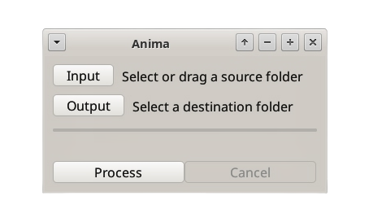
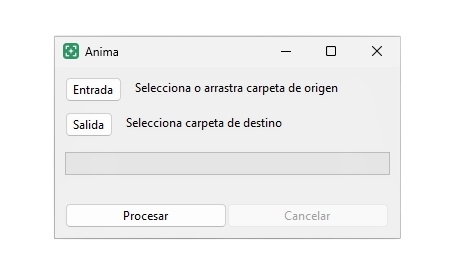

# Anima

**Sort camera trap photos and videos automatically: keep only the ones with an
animal or a person, skip the empty triggers. Runs offline on your computer
with MegaDetector v6**


[](LICENSE)

Most camera traps (trail cameras, wildlife cameras) use a passive infrared
(PIR) sensor that fires on a change in heat plus movement. Sun-warmed
branches or grass moving in the wind, patches of sunlight and hot air can set
it off too, so a single card can hold far more empty frames than real
sightings. Anima is a desktop app that goes through a
folder of camera trap images and videos, detects animals and people with
[MegaDetector v6](https://github.com/microsoft/CameraTraps), and copies only
the files where one appears to a separate folder. The originals are never
moved or modified.

```
SD card dump: 2,431 files ──► Anima ──► Output folder: 187 files with an animal or a person
                                        (empty triggers left behind)
```

**Looking for a free app to remove empty camera trap photos offline?** Anima
filters blank images and videos from trail cameras on Windows and Linux, with
no account, no cloud upload and no internet connection. It detects animals
and people (vehicles are ignored) and copies the matches, keeping their
original dates. The interface is in English and Spanish.

Use it when:

- The camera **triggers by mistake** and fills the card with empty frames
- You get **false positives** from moving vegetation, sunlight or heat
- You have **many cameras or sessions mixed together** and only want the
  frames where something is actually there
- You want a **first pass before identifying species** by hand or with
  another tool




## Contents

- [Features](#features)
- [Using the app](#using-the-app)
- [Installing](#installing)
- [Building](#building)
- [How it works](#how-it-works)
- [Development](#development)
- [Known limitations](#known-limitations)
- [License](#license)
- [Credits](#credits)

## Features

- **Private and offline:** images never leave the computer. No internet, no
  account, no analytics
- **Animals and people:** MegaDetector v6 is trained on camera trap images
  from many ecosystems. Vehicles are detected but not copied
- **Photos and videos:** `.bmp .jpeg .jpg .png .tif .tiff .webp` and
  `.avi .m4v .mkv .mov .mp4 .mpeg .mpg .wmv`. Videos are checked at one frame
  per second and stop at the first detection
- **Safe:** files are copied, never moved. The copy keeps the original
  timestamps, so the capture date is preserved. Nothing in the output folder
  is overwritten: a repeated name is copied as `IMG_0001 (1).JPG`
- **Simple:** pick or drag a folder, pick a destination, click **Process**.
  Cancel at any time; what was already copied stays
- **Robust:** corrupt files and unrelated files (`Thumbs.db`, `.txt`) are
  skipped; paths with accents, `ñ` or spaces work
- **Bilingual:** English or Spanish interface, following the system language

## Using the app

1. Click **Input** and choose the folder with the photos and videos, or drag
   the folder onto the window
2. Click **Output** and choose a different, preferably empty, destination
   folder
3. Click **Process**. The bar shows progress file by file
4. When it says **Done**, open the output folder: it holds only the files
   with an animal or a person

Only the files directly inside the input folder are processed; subfolders
are not scanned. To process several cards, run each folder in turn into the
same output folder.

## Installing

Installers for Windows and Linux are on the
[GitHub releases](https://github.com/antruc/anima/releases). They include
Python, the model and every dependency: nothing else to install.

## Building

### Requirements

| What | Version |
|---|---|
| [Python](https://www.python.org/downloads/) | 3.10 or later |
| [Briefcase](https://briefcase.readthedocs.io/) | Latest |
| OS | Windows or Linux |

### Build

1. Clone the repository:

   ```bash
   git clone https://github.com/antruc/anima.git
   ```

2. Enter it and create a virtual environment:

   ```bash
   cd anima && python3 -m venv env
   ```

3. Activate it (on Windows: `env\Scripts\activate`):

   ```bash
   source env/bin/activate
   ```

4. Install Briefcase:

   ```bash
   pip install briefcase
   ```

5. Run the app from source:

   ```bash
   briefcase dev
   ```

6. Build the installer:

   ```bash
   briefcase package
   ```

`briefcase package` creates and builds the app first if needed. macOS is not
supported. For other packaging formats see the
[BeeWare tutorial](https://tutorial.beeware.org/en/latest/tutorial/tutorial-0/).

## How it works

```
file ──► frames ──► letterbox 640×640 ──► MegaDetector v6 (ONNX) ──► animal or person ≥ MIN_CONFIDENCE? ──► copy
         (1 per s in videos)
```

1. **Scan** the input folder for supported image and video extensions
2. **Read frames:** an image gives one frame; a video gives one frame per
   second, skipping the rest without decoding
3. **Preprocess:** scale to fit 640×640 on a gray canvas, as the model was
   trained
4. **Detect** with MegaDetector v6 compact (`MDV6-yolov10-c`), exported to
   ONNX with NMS built in and run on the CPU with ONNX Runtime
5. **Decide:** if any detection of class animal (0) or person (1) scores at
   least `MIN_CONFIDENCE`, the file is copied with `shutil.copy2`

The model loads once on the first run and is reused. Processing runs in a
background thread, so the window stays responsive.

### Tuning

All settings are constants at the top of [src/anima/app.py](src/anima/app.py):

| Constant | Default | Change it when |
|---|---|---|
| `MIN_CONFIDENCE` | `0.1` | Raise it if empty frames are still copied; lower it if animals are missed |
| `VIDEO_STEP_S` | `1.0` | Lower it if fast animals are missed in videos |
| `CLASSES` | `[0, 1]` | Remove `1` to ignore people, add `2` to keep vehicles |

The default `MIN_CONFIDENCE` is low on purpose: missing an animal is worse than copying
an extra empty photo. Calibrate it with a folder of your own photos: pick the
highest value that does not miss animals. Values below `0.05` have no effect,
as the model was exported with `conf=0.05`.

## Development

```bash
briefcase dev          # run from source
briefcase dev --test   # run the tests
```

| Path | What it does |
|---|---|
| [src/anima/app.py](src/anima/app.py) | Window, folder selection, detection loop and UI strings |
| [src/anima/dnd.py](src/anima/dnd.py) | Folder drag and drop through the native WinForms and GTK widgets |
| [src/anima/MDV6-yolov10-c.onnx](src/anima/MDV6-yolov10-c.onnx) | The bundled MegaDetector v6 model |
| [tests/](tests/) | Unit tests for preprocessing, detection, the bundled model, copying, video sampling and translations |

Toga has no drag and drop API, so `dnd.py` uses Toga's private `_impl`. Toga
is pinned to `0.5.7` in [pyproject.toml](pyproject.toml) for that reason:
check drag and drop before upgrading it.

To regenerate the model from the original weights:

```python
YOLO("MDV6-yolov10-c.pt").export(format="onnx", imgsz=640, nms=True, conf=0.05)
```

## Known limitations

- Subfolders are not scanned
- Detection runs on the CPU only; large folders of videos take a while
- With the default `MIN_CONFIDENCE`, some empty frames still get copied: it favors
  keeping every animal over discarding every empty frame
- Very small, distant or heavily hidden animals can be missed
- Windows and Linux only: macOS is not supported

## License

The code is under [GPL-3.0](LICENSE).

The bundled model, `MDV6-yolov10-c.onnx` (MegaDetector v6), is under
AGPL-3.0. Anyone distributing the app with the model must also comply with
the AGPL-3.0 terms for that part.

## Credits

- [MegaDetector](https://github.com/microsoft/CameraTraps) by Microsoft AI for
  Good and the PyTorch-Wildlife team: the detection model
- [ONNX Runtime](https://github.com/microsoft/onnxruntime): the inference
  engine
- [OpenCV](https://opencv.org): image and video decoding
- [Toga](https://github.com/beeware/toga) and
  [Briefcase](https://github.com/beeware/briefcase) by BeeWare: the interface
  and the installers
